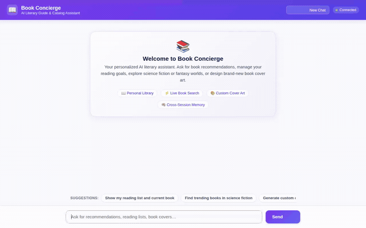

# 📖 Book Concierge

> An agent-first literary concierge and reading companion built on Google Cloud's Agent Development Kit (ADK) and Gemini models.

[](https://book-concierge-frontend-796910223127.us-central1.run.app)

🔗 **Live Demo (Active during workshop)**: [https://book-concierge-frontend-796910223127.us-central1.run.app](https://book-concierge-frontend-796910223127.us-central1.run.app)  
*(Note: Deployed on a temporary Google Cloud workshop sandbox. To run or deploy permanently on your own GCP account, see the setup instructions below).*



---

## 🌟 Overview

**Book Concierge** is an intelligent reading companion and book management assistant. Built with Google's **Agent Development Kit (ADK)** and powered by **Gemini 3.8 Flash**, Book Concierge helps readers track their reading habits, catalog books, discover trending titles, retrieve external library records, and dynamically generate custom cover artwork and cinematic video trailers.

---

## 🛠️ Implemented Capabilities & Wired Cloud Services

Every capability listed below is implemented in code and wired to active services:

| Layer / Service | Wired Component | What It Does |
|---|---|---|
| 🤖 **Agent Reasoning** | `Gemini 3.8 Flash` via ADK | Multi-turn conversational reasoning loop running in `global` location |
| 🧠 **Cross-Session Memory** | **Vertex AI Memory Bank** | Long-term memory persistence across sessions via `PreloadMemoryTool` and `generate_memories_callback` (`add_session_to_memory`) |
| 🗄️ **Structured Database** | **Google Cloud Firestore** | Stores catalog items, reading lists (`want_to_read`, `reading`, `read`), genres, and user ratings |
| 🖼️ **Public Asset Storage** | **Google Cloud Storage** | Dedicated bucket storing uploaded cover images (`covers/`) and video trailers (`trailers/`) with public HTTPS URLs |
| 🎨 **Cover Art Generation** | `gemini-3.1-flash-lite-image` | On-demand book cover illustration generation saved to session artifacts and Cloud Storage |
| 🎬 **Cinematic Video Trailers** | `gemini-omni-flash-preview` | Short atmospheric video teaser generator for books, saved to session artifacts and Cloud Storage |
| 🪟 **Agent-First UI** | **A2UI v0.8** (Basic Catalog) | Renders structured response cards, columns, metadata, and book cover images directly in the UI |
| 🌐 **Web Frontend** | **FastAPI + Cloud Run** | Lightweight asynchronous web client and A2A proxy with custom dialogue theme, typing indicator, quick prompt pills, and an image lightbox modal |

---

## 🔧 Registered Agent Tools

The agent (`app/agent.py`) is equipped with the following active tools implemented in `app/tools.py`:

- **`list_books(genre, status, limit)`**: Queries Firestore for books filtered by reading status (`want_to_read`, `reading`, `read`) or genre.
- **`search_books(query, limit)`**: Searches local Firestore catalog records matching title or author keywords.
- **`get_book_details(book_id)`**: Fetches complete metadata for a specific book ID from Firestore.
- **`add_or_update_book(title, author, genre, ...)`**: Adds a new book or updates existing catalog records in Firestore.
- **`update_reading_status(book_id, status, rating)`**: Updates progress status and star ratings in Firestore.
- **`get_trending_books(subject, limit)`**: Fetches real-time trending literary works from the Open Library Subject API.
- **`search_online_books(query, limit)`**: Queries Open Library search API for public external book records.
- **`generate_book_cover(title, description, tool_context)`**: Generates high-resolution cover artwork using `gemini-3.1-flash-lite-image`, registers it in session artifacts, and uploads it to Cloud Storage.
- **`generate_book_trailer(title, theme, tool_context)`**: Generates short cinematic video teaser trailers using `gemini-omni-flash-preview`, saves to session artifacts, and uploads to Cloud Storage.

*(Note: Earlier project brief concepts like Guilt-O-Meter score calculators and procrastination penalties from the brainstorming exercise are planned, not yet implemented).*

---

## 🚀 Running Locally

### Prerequisites

1. Python 3.11+
2. [uv](https://docs.astral.sh/uv/) package manager
3. [Google Cloud CLI](https://cloud.google.com/sdk/docs/install) (`gcloud`) authenticated with access to Firestore and Vertex AI:
   ```bash
   gcloud auth login
   gcloud auth application-default login
   gcloud config set project <your-project-id>
   ```

### 1. Install Dependencies

From the project root:

```bash
cd book-concierge
uv sync
```

### 2. Run the Agent Playground

To interact with the raw ADK agent and test tools in the ADK development environment:

```bash
uv tool run google-agents-cli playground
```

### 3. Run the Web Frontend & Proxy

To run the custom chat frontend locally:

```bash
cd frontend
uv venv
source .venv/bin/activate
uv pip install -r requirements.txt

# Set your deployed reasoning engine resource name and agent directory
export AGENT_ENGINE_RESOURCE_NAME="projects/<project-id>/locations/<location>/reasoningEngines/<id>"
export AGENT_DIRECTORY="app"

uvicorn main:app --host 0.0.0.0 --port 8080 --reload
```

Then open your browser to the local server port to chat with Book Concierge.

---

## 🚢 Deployment

### Deploying Agent to Vertex AI Agent Runtime

Deploy the agent logic using `agents-cli`:

```bash
uv tool run google-agents-cli deploy
```

### Deploying Frontend to Cloud Run

Containerize and deploy the FastAPI frontend proxy to Cloud Run:

```bash
cd frontend
gcloud run deploy book-concierge-frontend \
  --source . \
  --region us-central1 \
  --set-env-vars AGENT_ENGINE_RESOURCE_NAME="projects/<project-id>/locations/<location>/reasoningEngines/<id>",AGENT_DIRECTORY="app" \
  --allow-unauthenticated
```
